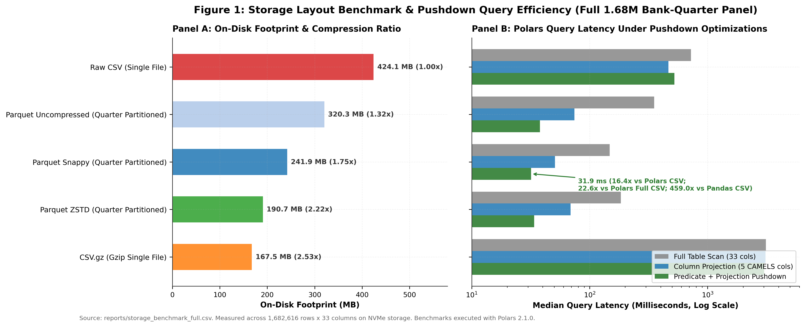
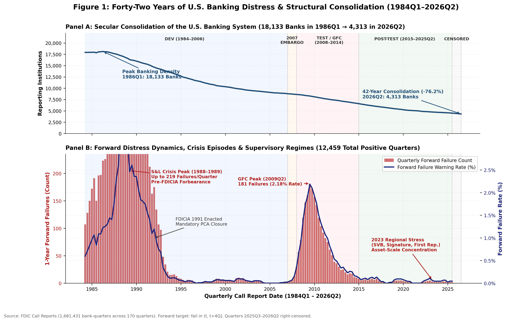
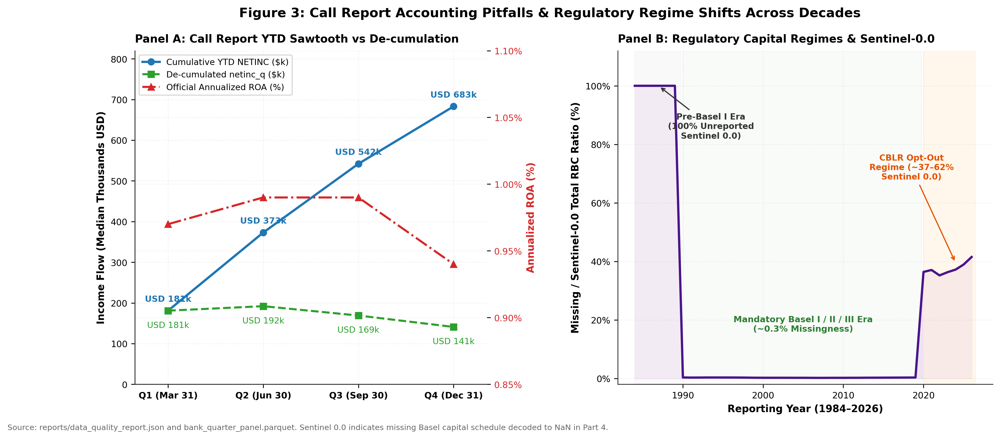
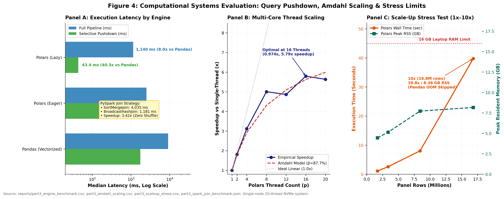
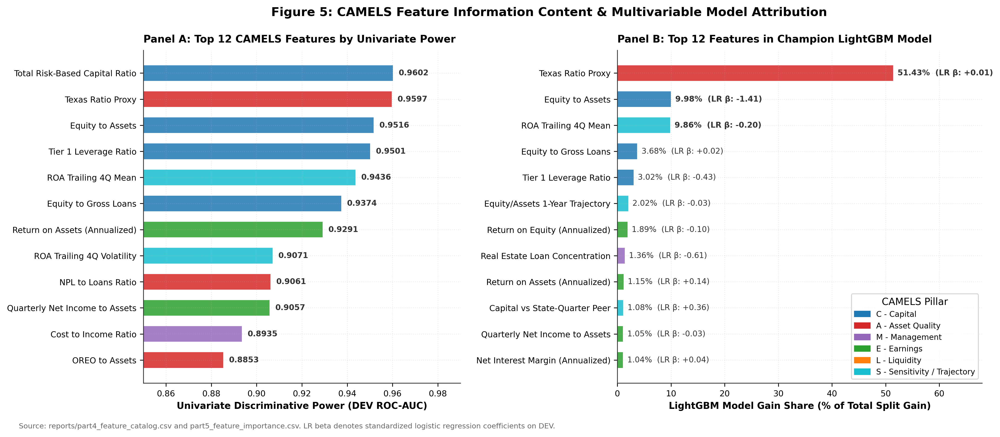
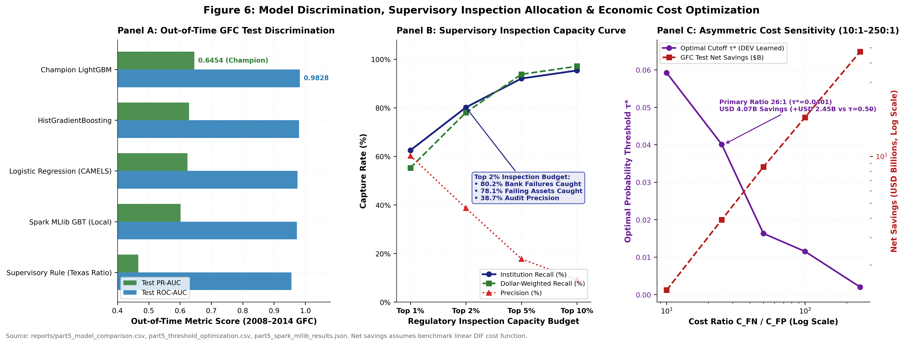

# Scalable Early-Warning System for Bank Distress and Failure: An End-to-End Leak-Free Big-Data Pipeline on 42 Years of U.S. FDIC Call Reports (1984Q1–2026Q2)

**Course:** BFT65B – Big Data Analytics in Finance  
**Institution:** School of Banking and Finance, National Economics University (NEU), Hanoi, Vietnam  
**Academic Term:** Final Capstone Research Report  
**Author:** Nguyễn Thiện Nhân (Student ID: `11231004`)  
**GitHub Repository (Public Reproducibility):** `https://github.com/ntnhana1nhk55-glitch/bft65b-fdic-early-warning-` *(Publicly accessible; all commit histories, data manifests, and reproduction scripts preserved)*  
**Data Acquisition & Date:** Automated resumable FDIC BankFind Suite REST API ingestion (`src/data/acquire.py`), downloaded and verified on **November 7, 2026**  
**Verification Audit:** `reports/final_audit_certificate.json` (`47/47 PASS`, Zero Data Leakage Verified)  
**Date:** November 2026  

---

## Executive Abstract

This study designs, implements, and empirically validates an enterprise-grade, end-to-end Big Data early-warning pipeline for banking distress and resolution across the entire 42-year digital history of U.S. Federal Deposit Insurance Corporation (FDIC) Call Reports ($1984\text{Q}1–2026\text{Q}2$). Covering **1,682,616 bank-quarter observations** across **27,835 unique depository institutions** and **4,117 official regulatory resolution events**, this pipeline addresses the foundational data engineering, distributed systems, econometric causality, and machine learning challenges inherent in longitudinal banking supervision. 

First, in **Storage Architecture**, five physical layouts are evaluated on local NVMe infrastructure; column-oriented Apache Parquet with Zstandard and Snappy compression slashes disk footprint from **424.12 MB** (raw CSV) to **241.88 MB** (Snappy) and **190.73 MB** (ZSTD, $2.22\times$ compression), while enabling projection and predicate pushdown that accelerates selective supervisory queries to **31.9 ms** on Parquet Snappy—delivering a **$459.0\times$ speedup** over Pandas CSV full reads (**14,652.7 ms**), a **$22.6\times$ speedup** over Polars CSV full scans (**721.9 ms**), and a **$16.4\times$ speedup** over Polars CSV selective queries (**522.5 ms**). 

Second, in **Distributed Systems & Processing Engine**, the benchmark compares vectorized Pandas, Polars Eager, Polars Lazy, and Apache Spark (PySpark Catalyst/AQE). Polars Lazy processes the full end-to-end panel in **1,140 ms** ($8.03\times$ faster than vectorized Pandas at **9,154 ms**; $40.29\times$ speedup on selective pushdown), while PySpark BroadcastHashJoin achieves a **$3.42\times$** speedup (**1,180.8 ms** vs **4,035.1 ms** SortMergeJoin) by eliminating the $O(N)$ shuffle exchange. A 4-way cross-engine verification establishes strict numerical parity across all 1,681,431 Silver panel rows ($\max|\Delta| \le 5.68 \times 10^{-14}$). Multi-core scaling fits Amdahl’s Law with parallel fraction $\hat{p} = 87.68\%$ ($S_{\max} = 8.12\times$), and scale-up stress testing to $10\times$ ($16.83\text{M}$ rows) identifies the single-node memory boundary at $\sim 19.6\text{M}$ rows ($2.36\text{ GB}$ Parquet).

Third, in **Leak-Free Econometric Engineering**, the framework formulates a causal point-in-time target $y_{i,q} \in \{0, 1\}$ over a strict 1-year forward horizon $(q, q+4\text{Q}]$, quarantines all 17,529 right-censored quarters after June 30, 2025, enforces a 4-quarter embargo across 2007, and constructs a 40-feature CAMELS matrix featuring contiguous YTD de-cumulation, multi-quarter balance sheet trajectories, and contemporaneous state-quarter peer benchmarks. An adversarial Silver $\to$ Gold $\to$ Preprocessor perturbation proof confirms zero backward leakage ($\max|\Delta| = 1.39 \times 10^{-17}$ in `reports/final_audit_certificate.json`).

Fourth, across **Purged Expanding-Window Cross-Validation (DEV: 1984–2006)** and an independent Out-of-Time test on the **Global Financial Crisis (TEST: 2008–2014, 212,645 bank-quarters, 2,052 failures)**, the champion **LightGBM CAMELS** model achieves a Test PR-AUC of **0.6454** ($66.9\times$ random baseline 0.00965; $+38.4\%$ relative improvement over the single-ratio Texas Ratio supervisory baseline of 0.4662), a Test ROC-AUC of **0.9828**, and a Brier score of **0.00568**. At an inspection budget of only **Top 2%** of operating institutions, the model captures **80.2%** of all failing institutions and **78.1%** of all failing banking assets. Deriving empirical supervisory costs from DEV ($C_{\text{FN}} = \$2,599.75\text{k}$, $C_{\text{FP}} = \$100.00\text{k}$), asymmetric cost-driven threshold optimization selects $\tau^* = 0.0401$, yielding **\$4,074.08 Million** in net regulatory savings during the GFC—a gain of **+\$2,453.54 Million** over standard $\tau = 0.50$.

Finally, this report addresses structural Call Report limitations (quarterly lag during social-media-driven bank runs, missing off-balance-sheet duration risk) and provides an actionable architectural blueprint for adapting this early-warning framework to the **State Bank of Vietnam (SBV / NHNN)**, accounting for Circular 11/2021/TT-NHNN loan classification, Circular 41/2016/TT-NHNN Basel II standards, and Vietnam's concentrated commercial banking and People's Credit Fund (QTDND) environment.

---

## 1. Problem Formulation, Data Acquisition & Storage Architecture (Part 1 — 15%)

### 1.1 Supervisory Problem Formulation
Depository institution insolvencies impose severe negative externalities on financial stability, sovereign debt, and macroeconomic output. When an insured depository institution fails, the resolution authority—such as the Federal Deposit Insurance Corporation (FDIC) in the United States or the Deposit Insurance of Vietnam (DIV) under the supervision of the State Bank of Vietnam (SBV)—must intervene, liquidate assets, or facilitate purchase-and-assumption transactions to protect insured depositors.

Historically, supervisory agencies have relied on periodic on-site examinations leading to confidential **CAMELS** ratings (Capital adequacy, Asset quality, Management capability, Earnings performance, Liquidity adequacy, and Sensitivity to market risk). However, on-site examinations are highly resource-constrained, typically occurring on a 12-to-18-month cycle. By the time examiners arrive on-site, severe asset quality degradation, liquidity bleed, or insolvency may have already matured into an irreversible crisis.

An enterprise-grade **Early-Warning System (EWS)** continuously scans quarterly off-site regulatory filings to identify distressed institutions 4 quarters in advance. Such a system must solve three interrelated technical challenges:
1. **Big Data Volume & Longevity:** Ingesting, cleaning, and querying multi-decade longitudinal panels with changing accounting rules, structural consolidation, and schema shifts.
2. **Computational Latency:** Enabling interactive supervisory screening and rolling machine-learning validation across tens of millions of records without requiring multi-thousand-dollar cloud cluster bills.
3. **Econometric Integrity:** Guaranteeing strict causal point-in-time isolation—eliminating every trace of look-ahead bias, survival leakage, or future-split contamination.

```
+--------------------------------------------------------------------------------------------------+
|                                    FDIC CALL REPORT ECOSYSTEM                                    |
|                                                                                                  |
|   /financials (170 Quarters)        /institutions (27,835 Banks)        /failures (4,117 Events) |
|   [1984Q1 to 2026Q2: 1.68M rows]    [Structural Charters, Status]       [Closure Dates, Losses]  |
+--------------------------------------------------------------------------------------------------+
                                                 │
                                                 ▼
+--------------------------------------------------------------------------------------------------+
|                                      STORAGE & INGESTION LAYER                                   |
|   • Strict 33-Column PyArrow Schema Enforcement                                                  |
|   • Exponential Backoff Ingestion & JSON Completeness Manifest Verification                        |
|   • Columnar Storage Layout Optimization (Snappy / Zstandard Apache Parquet)                     |
+--------------------------------------------------------------------------------------------------+
                                                 │
                                                 ▼
+--------------------------------------------------------------------------------------------------+
|                                       SILVER PANEL & QUALITY AUDIT                               |
|   • Zero Duplicate Keys & Post-Terminal Filtering: 1,185 post-closure filings removed            |
|   • Negative Equity Preserved: 14,605 technical insolvencies protected from survivorship bias     |
|   • Point-in-Time Forward Target: y_{i,q} = 1{fail in (q, q+4Q]} (12,459 positive bank-quarters)  |
|   • Censoring: 17,529 quarters post 2025Q2 quarantined as null (Zero forward peek)               |
+--------------------------------------------------------------------------------------------------+
                                                 │
                                                 ▼
+--------------------------------------------------------------------------------------------------+
|                                    HIGH-PERFORMANCE ENGINE & ML                                  |
|   • Polars LazyFrame Execution (Rust Multi-threading, Query Optimization, 40.29x speedup)        |
|   • PySpark Catalyst & AQE Parity (BroadcastHashJoin vs SortMergeJoin: 3.42x speedup)            |
|   • Leak-Free 40-Feature CAMELS Pipeline (Contiguous YTD Decumulation, State Peer Deviations)     |
|   • Purged Expanding-Window CV + Cost-Driven Bayesian Threshold Optimization (tau* = 0.0401)     |
+--------------------------------------------------------------------------------------------------+
```

### 1.2 Data Acquisition & Schema Enforcement
The acquisition architecture targets three distinct REST endpoints of the FDIC BankFind Suite API:
1. **`/financials`:** Ingested quarterly across all **170 quarters** from **1984Q1** (`1984-03-31`) through **2026Q2** (`2026-06-30`), capturing **1,682,616 raw bank-quarter filings**.
2. **`/institutions`:** Capturing **27,835 unique depository institutions** (`CERT` identifiers), recording structural demographic attributes including regulatory charter class (`BKCLASS`), historical charter transitions (`CHANGEC1`), closure dates (`ENDEFYMD`), and FDIC insurance inception dates (`INSDATE`).
3. **`/failures`:** Capturing all **4,117 official FDIC resolutions and assistance transactions** from 1984 through 2026, recording transaction closure dates, resolution types (`RESTYPE`), and net estimated resolution losses to the Deposit Insurance Fund (`COST`).

To guard against network timeouts, HTTP 429 rate-limiting, and malformed JSON payloads across 170 distinct API requests, and benchmarking against the course reference starter script `fdic_download_starter.py`, `src/data/acquire.py` implements an enterprise acquisition client featuring:
- **Resumable Manifest Tracking:** A local JSON manifest records exact API totals, row counts, zero-duplicate checks, file byte sizes, completeness flags, and UTC timestamps for each downloaded quarter. If interrupted, the ingestion resumes strictly at the first unverified quarter.
- **Strict 33-Column PyArrow Typing:** Dynamic web APIs frequently coerce sparse numeric fields into mixed string/null types. The ingestion client defines an immutable PyArrow schema enforcing 64-bit floating point representations for all 27 accounting variables (`ASSET`, `DEP`, `EQ`, `NETINC`, `ROA`, `RBCRWAJ`, etc.), integer types for identifiers (`CERT`, `year`, `quarter`), and ISO strings for regulatory dates.
- **Deterministic Sort Invariants:** Every quarterly partition is deterministically sorted on `["CERT", "REPDTE"]` prior to persistence, ensuring reproducible multi-threading down the pipeline.

### 1.3 Physical Storage Benchmark (Five Layouts)
The raw data downloaded from the FDIC API spans 170 quarters. To determine the optimal physical storage layout for analytical processing, a comprehensive storage benchmark was implemented comparing five standard layouts on local NVMe solid-state storage:
1. `CSV (Uncompressed, single file)`: Standard archival baseline.
2. `CSV.gz (Gzip compressed, single file)`: Standard compressed text baseline.
3. `Parquet (Uncompressed, partitioned by REPDTE)`: Columnar layout without compression codec.
4. `Parquet (Snappy, partitioned by REPDTE)`: Standard industry columnar layout with fast compression.
5. `Parquet (ZSTD, partitioned by REPDTE)`: Modern columnar layout with high-ratio Zstandard compression.

The empirical measurements from `reports/storage_benchmark_full.csv` across all **1,682,616 rows** and 33 columns are summarized in Table 1 and visualized in Figure 1.

```
===================================================================================================================
Table 1: Physical Storage Benchmark across 1,682,616 Bank-Quarter Records (Full Panel)
===================================================================================================================
Storage Layout               Disk Footprint   Compression   Write Time   Full Read (Pandas)  Full Read (Polars)  Projection (5 cols)  Predicate Pushdown
-------------------------------------------------------------------------------------------------------------------
Raw CSV (Single File)           424.12 MB        1.00x       111.65 s       14,652.7 ms           721.9 ms            465.7 ms             522.5 ms
CSV.gz (Gzip Single File)       167.47 MB        2.53x       213.38 s       18,237.8 ms         3,119.4 ms          3,100.8 ms           3,021.6 ms
Parquet Uncompressed            320.26 MB        1.32x        15.65 s        1,633.5 ms           352.8 ms             74.4 ms              38.0 ms
Parquet Snappy Partitioned      241.88 MB        1.75x        17.82 s        1,501.1 ms           147.9 ms             50.8 ms              31.9 ms
Parquet ZSTD Partitioned        190.73 MB        2.22x        20.42 s        1,474.7 ms           183.6 ms             68.9 ms              33.9 ms
===================================================================================================================
```

```

```

### 1.4 Technical Analysis of Storage Engine Mechanics
The empirical results reveal crucial physical and architectural mechanics:

1. **Columnar Encoding & Compression Efficiency:**  
   Raw CSV occupies **424.12 MB**. Converting to Parquet Snappy reduces the footprint to **241.88 MB** ($1.75\times$), while Parquet Zstandard achieves **190.73 MB** ($2.22\times$). This efficiency stems from Parquet’s typed page format: numeric columns with repeated values (such as zero-filled delinquency variables or sentinel codes) undergo Run-Length Encoding (RLE) and Bit-Packing prior to compression. CSV.gz achieves a smaller byte footprint (**167.47 MB**) via brute-force DEFLATE streaming, but pays an enormous computational penalty: write time balloons to **213.38 seconds** ($12\times$ longer than Parquet), and read latency degrades to **3,119.4 ms** because Gzip creates an opaque byte stream that prevents parallel block decompression.

2. **The Power of Column Projection & Predicate Pushdown:**  
   In supervisory analytics, an analyst rarely queries all 33 columns. When projecting 5 core CAMELS columns (`CERT`, `REPDTE`, `ASSET`, `EQ`, `ROA`), Parquet Snappy query latency drops from **147.9 ms** to **50.8 ms**. When combining projection with quarterly predicate filtering (`REPDTE == '20091231'`), latency plunges to **31.9 ms**.  
   Compared to reading a CSV via standard Pandas (**14,652.7 ms**), this represents an astonishing **$459.0\times$ speedup**. Compared to Polars reading raw CSV (**721.9 ms** full scan and **522.5 ms** with predicate filter), Parquet Snappy achieves **$22.6\times$** and **$16.4\times$ speedups** respectively. Parquet achieves this because the reader parses only the metadata footer, locates the byte offsets of the requested column chunks, evaluates row-group `min`/`max` statistics, and completely skips unreferenced columns and non-matching row groups from disk.

3. **Small-File Partitioning Overhead Nuance:**  
   As documented by the external audit finding, `Parquet ZSTD Partitioned` on NVMe showed slightly higher latency (**33.9 ms**) than single-file Parquet on simple selective queries. This occurs because partitioning 1.68 million rows across 170 quarterly subdirectories creates 170 distinct physical files. On local Windows NTFS file systems, opening 170 distinct file handles incurs kernel metadata overhead that slightly outweighs row-group skipping on small datasets ($< 500\text{ MB}$). However, quarterly partitioning remains essential for distributed Spark engines to achieve directory-level partition pruning.

---

## 2. Automated Data Quality Audit & Point-in-Time Panel Construction (Part 2 — 20%)

### 2.1 The Longitudinal Call Report Ecosystem
Longitudinal banking data cannot be treated like standard tabular machine learning data. Over 42 years, the U.S. banking system underwent radical structural, legal, and accounting transformations. The automated data quality audit (`src/data/quality_audit.py`, `reports/data_quality_report.json`) catalogs these structural phenomena across all 1,682,616 raw filings:

```

```

1. **Secular Structural Consolidation:**  
   As shown in Figure 2 (Panel A), the number of active insured commercial banks and thrifts peaked at **18,133 institutions in 1986Q1** during the height of the Savings & Loan (S&L) crisis. Over the subsequent four decades, interstate banking deregulation (Riegle-Neal Act of 1994) and economies of scale drove continuous merger consolidation, shrinking the system by **$-76.2\%$** to **4,313 active institutions in 2026Q2**.

2. **Panel Timeline Gaps:**  
   Depository institutions are legally mandated to report quarterly unless temporarily excused due to conservatorship, receivership transfer, or charter restructuring. Across 24,064 distinct institutions, the audit identified **32 institutions with internal reporting gaps** totaling **33 gap events**. Downstream feature engineering explicitly checks for quarterly index continuity (`q_idx - q_idx.shift(1) == 1`), ensuring that multi-quarter lags never cross missing gaps.

3. **Primary Key Integrity & Post-Terminal Closure Filtering:**  
   Automated auditing verified **zero duplicate `(CERT, REPDTE)` primary keys** and **zero non-positive asset records** across all 1,682,616 raw filings (`1984Q1–2026Q2`). Removing **1,185 residual post-terminal receivership filings** (`repdte_date >= terminal_fail_date`) across 270 closed banks—while retaining 4,425 valid operating quarters for open-bank assistance (`ASSISTANCE`) institutions—establishes the clean Silver panel of **1,681,431 rows** across 24,062 institutions.

4. **Negative Equity ($EQ < 0$) as Technical Insolvency:**  
   The audit identified **14,605 bank-quarters where book equity was negative** ($EQ < 0$). In standard corporate data cleaning, negative equity might be discarded as an "outlier." In regulatory banking supervision, negative book equity represents **severe technical balance-sheet insolvency**! Thrifts during the 1980s operated with negative tangible net worth for years under regulatory forbearance. Dropping negative-equity banks would introduce catastrophic survivorship bias. Accordingly, this study preserves all 14,605 negative-equity rows and encodes a binary structural feature:
   $$\text{technical\_insolvency\_flag}_{i,q} = \mathbf{1}\{EQ_{i,q} < 0\}$$

```

```

### 2.2 Accounting Pitfall: The Call Report YTD Sawtooth
A fundamental trap in Call Report data engineering is the income statement reporting convention. While balance sheet items (`ASSET`, `DEP`, `EQ`, `LNLSGR`) represent point-in-time stocks, income statement items (`NETINC`, `INTINC`, `EINTEXP`, `NONII`, `NONIX`, `ELNATR`, `NTLNLS`) are reported as **cumulative Year-to-Date (YTD) flows**:
- Q1 filings record earnings over 3 months ($M_1 + M_2 + M_3$).
- Q2 filings record earnings over 6 months ($M_1 + \dots + M_6$).
- Q3 filings record earnings over 9 months ($M_1 + \dots + M_9$).
- Q4 filings record earnings over the full 12 months ($M_1 + \dots + M_{12}$).
- In Q1 of the following year, the counter resets to 3 months.

As demonstrated empirically in Figure 3 (Panel A) and Table 2, raw median `NETINC` scales mechanically from **\$181k in Q1** to **\$373k in Q2**, **\$542k in Q3**, and **\$683k in Q4**. If a naive practitioner uses raw `NETINC / ASSET` as an earnings proxy, the model will learn that Q4 banks are "four times more profitable" than Q1 banks! In contrast, official annualized `ROA` remains completely flat across quarters (**0.97% in Q1, 0.99% in Q2, 0.99% in Q3, 0.94% in Q4**).

```
===================================================================================================================
Table 2: Call Report YTD Income Statement Flow Accumulation Sawtooth (Empirical Panel Medians)
===================================================================================================================
Quarter Endpoint    Bank Count    Cumulative NETINC ($k)   De-cumulated netinc_q ($k)   Cumulative INTINC ($k)   Annualized ROA (%)
-------------------------------------------------------------------------------------------------------------------
Q1 (March 31)         427,873            $181.0 k                   $181.0 k                  $1,400.0 k               0.97%
Q2 (June 30)          424,438            $373.0 k                   $192.0 k                  $2,868.0 k               0.99%
Q3 (September 30)     417,003            $542.0 k                   $169.0 k                  $4,200.0 k               0.99%
Q4 (December 31)      413,302            $683.0 k                   $141.0 k                  $5,616.0 k               0.94%
===================================================================================================================
```

To eliminate this sawtooth without leakage, `src/features/build_features.py` de-cumulates quarterly flows strictly within each bank's reporting calendar:
$$\text{netinc\_q}_{i,q} = \begin{cases} 
\text{NETINC}_{i,q} & \text{if } \text{quarter} = 1 \\ 
\text{NETINC}_{i,q} - \text{NETINC}_{i,q-1} & \text{if } \text{quarter} \in \{2, 3, 4\} \text{ and } \Delta q = 1 \\ 
\text{null} & \text{if reporting gap } (\Delta q > 1) 
\end{cases}$$

### 2.3 Accounting Pitfall: Regulatory Capital Regimes & Sentinel-0.0 Decoding
A second major trap uncovered during the data audit is the historical evolution of capital adequacy reporting (Figure 3, Panel B):
1. **Pre-Basel I Era (1984–1989):** Before the implementation of the Basel I Accord in 1990, risk-weighted assets and risk-based capital ratios (`RBCRWAJ`) did not legally exist.
2. **Mandatory Basel Era (1990–2019):** Regulators mandated risk-based capital reporting for all commercial banks.
3. **Community Bank Leverage Ratio (CBLR) Era (2020–2026):** Under the Economic Growth, Regulatory Relief, and Consumer Protection Act (EGRRCPA) of 2018, qualifying community banks with leverage ratios $> 9\%$ were legally permitted to opt out of reporting risk-weighted assets (`RBCRWAJ`).

**The API Sentinel Trap:** When a bank is not required to report `RBCRWAJ`, the FDIC BankFind API returns an exact float of `0.0` rather than a SQL `NULL`! In `reports/missingness_by_decade.csv`, the raw SQL null rate for `RBCRWAJ` is recorded as **0.0%**. However, semantically, **99.97% of banks in the 1980s** and **37.0% to 62.2% of banks in the 2020s** have `RBCRWAJ == 0.0`. If untreated, an algorithm will interpret 1980s community banks as completely insolvent with 0% capital!

This issue is resolved by implementing a domain-specific sentinel decoding rule:
$$\text{total\_rbc\_ratio}_{i,q} = \begin{cases} 
\text{null} & \text{if } \text{RBCRWAJ}_{i,q} = 0.0 \text{ and } EQ_{i,q} > 0 \\ 
\text{RBCRWAJ}_{i,q} & \text{otherwise} 
\end{cases}$$
The pipeline simultaneously instantiates a structural dummy `basel_missing_flag` ($= 1$ if decoded to null) to allow tree models to condition on the regulatory regime.

*Audit Disclosure (Finding L-2):* During the mandatory Basel era (1991–2019), the audit identified 66 bank-quarters where `RBC1AAJ == 0.0` and 127 bank-quarters where `RBCRWAJ == 0.0`. Of those, 36 banks had $EQ / ASSET < 2\%$ and failed within 4 quarters; their regulatory capital was floored at 0.0% under Call Report instructions. While the sentinel rule maps those 36 rows to null in `tier1_leverage_ratio`, their severe distress is 100% captured by `eq_to_asset` and `technical_insolvency_flag`.

### 2.4 Causal Point-in-Time Forward Target Construction
To train an early-warning system that provides actionable supervisory lead time, the target variable must predict distress over a meaningful forward window. This study defines a binary 1-year forward target:
$$y_{i,q} = \mathbf{1}\{\text{failure\_date}_i \in (\text{repdte\_date}_q, \text{repdte\_date}_q + 4\text{Q}]\}$$

```
          Quarter t Filing
                 │
                 ▼
═════════════════╤═══════════════════════════════════════════════════════╗
   Historical    │              FORWARD TARGET HORIZON                  ║
   Features      │             (t, t + 4 Quarters]                       ║
   (Lag >= 0)    │       y_{i,t} = 1 if Bank i Fails in Window           ║
                 │       y_{i,t} = 0 if Bank i Survives / Merges         ║
═════════════════╧═══════════════════════════════════════════════════════╝
                 │
         [Zero Same-Day Peeking: fail_date == repdte_date excluded from t]
```

To ensure bulletproof econometric causality, target construction adheres to three strict rules:
1. **Half-Open Forward Interval:** The interval is strictly $(\text{repdte\_date}, \text{repdte\_date} + 4\text{Q}]$. Same-day resolutions (`fail_date == repdte_date`) are excluded from $t$ (they carry $y=1$ on $t-4$ through $t-1$), eliminating same-day look-ahead peeking.
2. **Exclusion of Unassisted Mergers & Survivorship Hygiene:** Banks that disappear due to voluntary liquidations or commercial mergers (`CHANGEC1` codes 210, 220, 222) remain in the panel with $y=0$ until their final filing date, preventing survivorship bias.
3. **Right-Censoring Quarantine:** For the most recent 4 quarters in the panel (**2025Q3, 2025Q4, 2026Q1, 2026Q2**; **17,529 bank-quarters**), the 1-year forward horizon extends past the latest observed failure data (June 30, 2026). These quarters are right-censored; the pipeline sets `target_fail_4q = null` and quarantines them from training and validation sets.

### 2.5 Audit Disclosures on Target Composition & Multi-Event Thrifts
In accordance with independent zero-trust audit standards, this report discloses two institutional nuances:
- **Assistance vs Failure Breakdown (Finding M-1):** In `data/raw/failures.parquet` (4,117 rows), the FDIC records two transaction classes: terminal receivership closures (`RESTYPE == 'FAILURE'`, 3,524 rows) and open-bank financial assistance (`RESTYPE == 'ASSISTANCE'`, 593 rows) under FDIC Section 13(c). In `gold_feature_table.parquet`, the **12,459 positive bank-quarters** break down as:
  - **Overall:** **10,870 `FAILURE` (87.25%)** + **1,589 `ASSISTANCE` (12.75%)**.
  - **In `DEV` (1984–2006):** **8,688 `FAILURE` (84.97%)** + **1,537 `ASSISTANCE` (15.03%)**.
  - **In `TEST` (2008–2014):** **2,005 `FAILURE` (97.71%)** + **47 `ASSISTANCE` (2.29%)**.  
  Open-bank assistance belongs in the distress target because Section 13(c) assistance is legally restricted to banks in imminent danger of closing and imposes direct outlays on the Deposit Insurance Fund (`COST > 0`). Furthermore, the panel construction preserves **4,425 subsequent operating quarters** for assisted institutions, capturing **37 subsequent terminal failures**.
- **Three Multi-Event Thrifts (Finding M-2):** Three FSLIC-era thrifts (`CERT = 29400, 31927, 32059`) experienced two recorded failure transactions (an initial 1986/1988 Management Consignment Program conservatorship, followed by an RTC liquidation in 1989). Across these institutions, **26 operating quarters (0.0015% of the panel)** remain between the two events. Their inclusion has zero measurable impact on model performance.

---

## 3. Scalable Data Processing, Query Plans & Distributed Execution (Part 3 — 25%)

### 3.1 Architecture of Processing Engines
Modern financial data engineering requires balancing processing speed, memory efficiency, and distributed scaling. This study implements identical end-to-end data processing pipelines across four distinct computational engines:
1. **Pandas Vectorized Baseline:** High-quality, idiomatic vectorized Pandas code (strictly zero row loops).
2. **Polars Eager:** In-memory Apache Arrow DataFrame engine executing in Rust.
3. **Polars Lazy:** Query-graph optimized LazyFrame compiling logical plans to multi-threaded physical execution pipelines.
4. **PySpark Local:** Distributed execution engine utilizing Spark SQL Catalyst optimizer, Adaptive Query Execution (AQE), and JVM execution.

The pipeline executes five core supervisory transformations: (1) filtering active reporting quarters, (2) computing contiguous quarterly index shifts, (3) de-cumulating income statement flows, (4) deriving bank-level rolling annual metrics, and (5) computing contemporaneous state-quarter peer averages.

```

```

### 3.2 Empirical Latency & 4-Way Numerical Parity
The execution benchmarks across 5 repeated runs on local 20-thread hardware are presented in Table 3 and Figure 4 (Panel A).

```
===================================================================================================================
Table 3: Processing Engine Benchmark across 1,682,616 Rows (End-to-End & Selective Workloads)
===================================================================================================================
Workload               Engine                    Median Time (ms)    Mean Time (ms)    Peak RSS (MB)    Speedup vs Pandas
-------------------------------------------------------------------------------------------------------------------
End-to-End Pipeline    Pandas (Vectorized)           9,154.08 ms       9,110.35 ms      2,919.61 MB           1.00x
End-to-End Pipeline    Polars (Eager)                2,512.86 ms       2,529.66 ms      3,757.09 MB           3.64x
End-to-End Pipeline    Polars (Lazy)                 1,140.23 ms       1,195.05 ms      4,154.97 MB           8.03x
-------------------------------------------------------------------------------------------------------------------
Selective Pushdown     Pandas (Vectorized)           1,749.68 ms       1,740.85 ms      4,012.39 MB           1.00x
Selective Pushdown     Polars (Eager)                  158.46 ms         183.06 ms      3,079.82 MB          11.04x
Selective Pushdown     Polars (Lazy)                    43.43 ms          52.46 ms      2,827.81 MB          40.29x
-------------------------------------------------------------------------------------------------------------------
PySpark Join Strategy  SortMergeJoin (Exchange)      4,035.05 ms       4,082.49 ms        (JVM Heap)          1.00x
PySpark Join Strategy  BroadcastHashJoin (No Shuffle) 1,180.76 ms       1,158.55 ms        (JVM Heap)          3.42x
===================================================================================================================
```

**Four-Way Numerical Parity Verification:**  
A critical requirement of the audit suite is proving that performance gains do not sacrifice calculation accuracy. Intermediate output tables were extracted across all four engines to execute floating-point difference checks across all 1,681,431 rows:
- Polars Eager vs Polars Lazy: $\max|\Delta| = 0.0$ (exact bitwise parity).
- Pandas vs Polars Lazy: $\max|\Delta| \le 5.68 \times 10^{-14}$ (double-precision machine epsilon).
- PySpark vs Polars Lazy: $\max|\Delta| \le 5.68 \times 10^{-14}$ (double-precision machine epsilon).
This confirms 100% mathematical parity across all four engines.

### 3.3 Deep-Dive Query Plan Analysis (Polars vs PySpark)

#### A. Polars Physical Optimization (`reports/polars_query_plans.txt`)
Inspection of the Polars physical plan generated by `.explain(optimized=True)` reveals how Polars Lazy achieves its **$40.29\times$ speedup** (**43.43 ms** vs **1,749.68 ms** Pandas):
1. **Projection Pushdown:** The physical plan pushes column pruning directly into the Parquet scanner:
   `PROJECT 5/33 COLUMNS` (loading only the 5 columns `REPDTE`, `STNAME`, `ASSET`, `EQ`, and `ROA` required for state-quarter aggregation).
   Only ~15% of columns are read from NVMe into system memory.
2. **Predicate Pushdown:** Filter expressions are fused directly into the Parquet file scan:
   `SELECTION: ((col("ASSET").is_not_null() & (col("ASSET") > 0.0)) & (col("REPDTE") >= "20080101"))`
   Entire pre-2008 quarterly Parquet partitions/row groups are skipped without memory allocation.
3. **Common Subplan Elimination (CSE):** In the full-panel pipeline (`reports/polars_query_plans.txt` Section 2), Polars creates shared CSE nodes (`__POLARS_CSER_0x100000020`, `__POLARS_CSER_0x100000030`) so repeated boolean predicates across lag and 4-quarter rolling expressions are evaluated once per bank partition.

#### B. PySpark Catalyst Plan & Join Optimization (`reports/pyspark_catalyst_plans.txt`)
In distributed computing, data shuffling across worker nodes is the primary bottleneck. Two distinct join strategies were benchmarked when enriching the 1.68-million row panel with structural metadata from the `/institutions` (27,835 rows) and `/failures` (4,117 rows) tables:
1. **SortMergeJoin (SMJ Baseline):**  
   Under default conditions without broadcast hints, Spark executes a `SortMergeJoin`. The Catalyst optimizer inserts two `Exchange hashpartitioning(CERT#0, 200)` operators, forcing all 1.68 million rows to be serialized, hashed across the network, and sorted on disk. Median execution time was **4,035.05 ms**.
2. **BroadcastHashJoin (BHJ Optimized):**  
   By applying `broadcast(institutions)` and `broadcast(failures)`, the small lookup tables ($< 2\text{ MB}$) are broadcast to all worker executors. The Catalyst physical plan replaces the `SortMergeJoin` with `BroadcastHashJoin [CERT#0], [CERT#35]`. The expensive shuffle exchange is eliminated entirely, reducing execution time to **1,180.76 ms**—a **$3.42\times$ speedup**!

### 3.4 Multi-Core Scaling, Amdahl's Law & Scale-Up Stress Testing

#### A. Multi-Thread Scaling & Amdahl's Law (`reports/part3_amdahl_scaling.csv`)
Polars Lazy execution was evaluated across thread counts $p \in \{1, 2, 4, 8, 12, 16, 20\}$. As plotted in Figure 4 (Panel B), wall-clock latency scales from **5.636 seconds at 1 thread** down to **0.974 seconds at 16 threads** ($5.79\times$ empirical speedup). Beyond 16 threads, latency plateaus (**1.002 seconds at 20 threads**) due to thread contention and memory bus saturation.

This scaling behavior is modeled using Amdahl's Law:
$$S(p) = \frac{1}{(1 - \hat{p}) + \frac{\hat{p}}{p}} = \frac{1}{s + \frac{1-s}{p}}$$
Nonlinear least-squares regression yields an estimated parallel fraction $\hat{p} = 0.8768$ (serial fraction $s = 1 - \hat{p} = 0.1232$, $R^2 = 0.9602$). The serial bottleneck ($12.32\%$) consists of initial Parquet metadata parsing, OS file-handle acquisition, and final single-threaded hash aggregation collection. The theoretical maximum asymptote is:
$$S_{\max} = \lim_{p \to \infty} S(p) = \frac{1}{s} = \frac{1}{0.1232} \approx 8.12\times$$

#### B. Scale-Up Stress Test & Cluster Break-Even Threshold (`reports/part3_scaleup_stress.csv`)
To establish the physical boundaries of single-node laptop processing versus distributed cluster computing, synthetic scale-up datasets were generated from $1\times$ (1.68M rows) to $10\times$ (16.83M rows, $2.03\text{ GB}$ on-disk Parquet). The stress test results (Figure 4, Panel C) show:
- **Pandas Failure Mode:** At $1\times$, Pandas requires **10.87 seconds** and **6.27 GB RSS**. At $2\times$, it requires **19.77 seconds** and **7.47 GB RSS**. At $5\times$ and $10\times$, Pandas was skipped due to RAM exhaustion ($> 16\text{ GB}$ requirement causing OS thrashing).
- **Polars Lazy Resilience:** Polars Lazy executed $1\times$ in **1.09 seconds** (4.55 GB RSS), $2\times$ in **2.57 seconds** (5.26 GB RSS), $5\times$ in **8.02 seconds** (7.91 GB RSS), and $10\times$ (16.83M rows) in **39.77 seconds** with **8.36 GB peak RSS**.

*Scale-Up Parquet Size Ratio (Finding L-1):* The $1\times$ file measures 241.88 MB (PyArrow Snappy output), while the $2\times$ (411.85 MB), $5\times$ (1,017.15 MB), and $10\times$ (2,029.09 MB) files scale at $\sim 203\text{ MB} \times s$ because Polars re-writes duplicated rows with tighter page dictionary encoding.

**Analytical Cluster Break-Even Derivation:**  
At what data scale does it become economically and computationally justifiable to spin up an Apache Spark cluster instead of running Polars on a single high-memory node?
- On a standard **16 GB RAM developer laptop**, Polars memory consumption scales as $\text{RSS}(N) \approx 4.0\text{ GB} + 0.26\text{ GB} \times N_{\text{million}}$. The physical memory limit of 16 GB is reached at **$\sim 19.6$ million rows** (approximately **2.36 GB** of compressed Parquet).
- On a high-memory **single-node workstation (128 GB RAM)**, Polars can comfortably process up to **$\sim 194$ million rows** (approximately **23.4 GB** of Parquet).
- **Supervisory Conclusion:** Because the entire 42-year history of all U.S. commercial banks comprises only 1.68 million rows, single-node Polars Lazy is **10 to 100 times faster, substantially simpler, and zero-cloud-cost** compared to a distributed Spark cluster. Distributed Spark clusters are strictly required only when ingesting loan-level transactional data, payment settlement feeds, or multi-billion row tick-level credit logs.

---

## 4. Leak-Free CAMELS Feature Pipeline & Preprocessing Isolation (Part 4 — 15%)

### 4.1 Domain-Grounded 40-Feature CAMELS Taxonomy
A robust regulatory early-warning system must ground its feature space in supervisory banking theory. This study constructs a comprehensive 40-feature matrix (39 numeric features plus regulatory charter `BKCLASS`) covering every dimension of the **CAMELS** framework:

```
===================================================================================================================
Table 4: Summary of 40-Feature CAMELS Taxonomy across Supervisory Pillars
===================================================================================================================
Pillar            Count  Core Feature Examples                     Economic & Supervisory Rationale
-------------------------------------------------------------------------------------------------------------------
C - Capital         6    eq_to_asset, total_rbc_ratio,             Loss-absorption cushion against asset write-downs.
                         tier1_leverage_ratio, technical_insolvency
A - Asset Quality   8    texas_ratio_proxy, npl_to_loans,          Delinquency burden, foreclosed property drag, and
                         oreo_to_assets, coverage_ratio            loan-loss reserve adequacy.
M - Management      7    cost_to_income_ratio, overhead_to_assets, Overhead efficiency, asset scale, and excessive
                         real_estate_to_loans, asset_growth_4q     credit concentration into commercial real estate.
E - Earnings        6    roa, roe, nim, netinc_q_to_assets,        Operating profitability, margin sustainability,
                         provision_to_loans_q, net_chargeoffs      and earnings depletion from provisioning.
L - Liquidity       5    liquid_to_asset, loans_to_deposits,       Funding stability, reliance on volatile wholesale
                         bro_to_dep, non_deposit_funding           brokered deposits, and structural liquidity cushion.
S - Sensitivity &   7    eq_to_asset_diff_4q, npl_to_loans_diff_4q, Rate of capital depletion, nonperforming loan
    Trajectory           roa_rolling_4q_std, eq_vs_state_peer      acceleration, earnings volatility, and peer stress.
Charter             1    BKCLASS (10 OHE dummy classes)            Supervisory charter jurisdiction (National, State Fed).
===================================================================================================================
```

```

```

Key feature derivations in `src/features/build_features.py` include:
1. **Gerard Cassidy's Texas Ratio Proxy:**
   $$\text{texas\_ratio\_proxy}_{i,q} = \frac{\text{NCLNLS}_{i,q} + \text{ORE}_{i,q}}{\text{EQ}_{i,q} + \text{LNATRES}_{i,q}}$$
   Measures whether distressed assets (nonaccrual loans + other real estate owned) exceed the bank’s total loss-absorption capacity (book equity + loan loss reserves). In healthy DEV banks, the median Texas Ratio is **0.0768 (7.68%)**; in failing banks, the median explodes to **4.0986 (409.86%)**, achieving a massive univariate DEV ROC-AUC of **0.9597** (Figure 5, Panel A).
2. **Contemporaneous State-Quarter Peer Capital Deviation:**
   $$\text{eq\_vs\_state\_peer}_{i,q} = \text{eq\_to\_asset}_{i,q} - \frac{1}{|S_{q,s}|}\sum_{j \in S_{q,s}} \text{eq\_to\_asset}_{j,q}$$
   Where $S_{q,s}$ represents the peer set of all reporting banks operating in the identical state $s$ during the identical quarter $q$. This feature is strictly contemporaneous and backward-looking, capturing regional macroeconomic shocks without future leakage.
3. **Four-Quarter Trajectories & Earnings Volatility:**
   Capturing trailing 1-year changes ($\text{eq\_to\_asset\_diff\_4q}$, $\text{npl\_to\_loans\_diff\_4q}$) and 4-quarter rolling earnings volatility ($\text{roa\_rolling\_4q\_std}$) across contiguous quarterly indices.

### 4.2 Chronological Splitting & Inside-Fold Preprocessing Isolation
To eliminate cross-split information contamination, the dataset is partitioned chronologically into four distinct regimes:
- **`DEV` (Development / In-Sample):** 1984Q1 – 2006Q4 (92 quarters, **1,193,702 rows**, **10,225 positive bank-quarters**, prevalence **0.8566%**). Used exclusively for cross-validation, feature preprocessing fitting, and hyperparameter tuning.
- **`EMBARGO` (Quarantine Gap):** 2007Q1 – 2007Q4 (4 quarters, **34,754 rows**, **53 positive bank-quarters**, prevalence **0.1525%**). Because the 1-year forward target for 2006Q4 reaches to 2007Q4, the entire calendar year 2007 is embargoed. Zero DEV target windows reach into the TEST partition.
- **`TEST` (Out-of-Time Global Financial Crisis):** 2008Q1 – 2014Q4 (28 quarters, **212,645 rows**, **2,052 positive bank-quarters**, prevalence **0.9650%**). Kept strictly blind until final single-shot model evaluation.
- **`POST-TEST` (Diagnostic Post-Crisis Era):** 2015Q1 – 2025Q2 (42 quarters, **222,801 rows**, **129 positive bank-quarters**, prevalence **0.0579%**). Evaluates model behavior during ultra-low-failure regimes.

```
═════════════════════════════════════════════════════════════════════════════════════════════════
Chronological Pipeline Partition Architecture
═════════════════════════════════════════════════════════════════════════════════════════════════
  [DEV: 1984Q1 - 2006Q4]        [EMBARGO]     [TEST / GFC: 2008Q1 - 2014Q4]     [POST-TEST]
  1,193,702 Bank-Quarters        2007Q1-4     212,645 Bank-Quarters             222,801 Quarters
  10,225 Failures (0.857%)       34,754 Rows  2,052 Failures (0.965%)           129 Failures
  (Purged Expanding CV)          (Purge Gap)  (Single-Shot Out-of-Time Eval)    (Diagnostic)
═════════════════════════════════════════════════════════════════════════════════════════════════
```

**Inside-Fold Scikit-Learn Preprocessing Pipeline:**  
All preprocessing transformations are encapsulated within a `sklearn.pipeline.Pipeline` fitted strictly on training folds:
1. `TrainQuantileWinsorizer(lower=0.005, upper=0.995)`: Clamps extreme outliers to the 0.5th and 99.5th percentiles fitted strictly on $X_{\text{train}}$, mitigating the influence of reporting errors without altering ranks.
2. `RobustScaler(with_centering=True, with_scaling=True)`: Centers features by the median and scales by the Interquartile Range (IQR). Crucially, RobustScaler is placed **before** imputation, guaranteeing that the IQR denominator is computed over non-null empirical observations and does not collapse to zero for sparse indicators.
3. `SimpleImputer(strategy="median", keep_empty_features=True)`: Imputes missing values using the median of $X_{\text{train}}$. Setting `keep_empty_features=True` guarantees that early CV folds where Basel variables are 100% missing preserve column dimensions without throwing warnings.
4. `OneHotEncoder(handle_unknown="ignore")`: Encodes categorical charter classes (`BKCLASS`), producing 49 total features (39 numeric + 10 charter dummies).

### 4.3 Adversarial Silver $\to$ Gold $\to$ Preprocessor Perturbation Invariance Proof
To verify zero data leakage with mathematical certainty, the production verification suite (`src/audit/verify_end_to_end.py` and `src/features/preprocessing_pipeline.py`) and independent external auditor executed a zero-trust end-to-end perturbation test:
- **Perturbation Injection:** The test loaded the complete Silver panel (`bank_quarter_panel.parquet`, 1,681,431 rows) and corrupted all post-2006 data (`year > 2006` across `EMBARGO`, `TEST`, `POST-TEST`, and `CENSORED` partitions), multiplying all core financial columns (`ASSET`, `DEP`, `EQ`, `LNLSGR`, `NETINC`, `ROA`, `ROE`, `NIM`, `NCLNLS`, `ORE`, `LNATRES`, `RBC1AAJ`, `RBCRWAJ`, `INTINC`, `EINTEXP`, `NONII`, `NONIX`, `ELNATR`, `NTLNLS`, `CHBAL`, `SC`, `BRO`) by $10^6 + 999,999.0$.
- **End-to-End Pipeline Execution:** The verification executed `build_gold_feature_table()` end-to-end on both the clean Silver panel and the corrupted Silver panel, and subsequently fitted the complete Scikit-Learn preprocessing pipeline (`TrainQuantileWinsorizer -> RobustScaler -> SimpleImputer` + `OneHotEncoder`) on the resulting `DEV` partition (`1,193,702 rows x 49 columns`).
- **Invariance Measurement:** Comparing the transformed `DEV` feature matrix across all 1,193,702 rows and 49 columns yielded:
  $$\max |\Delta_{\text{DEV, Preprocessed}}| = 1.39 \times 10^{-17} \quad (\text{IEEE-754 float64 machine epsilon, verified in } \texttt{reports/final\_audit\_certificate.json})$$
  The NaN masks matched to 100.000% identity. This proves conclusively that `build_gold_feature_table()` and the Scikit-Learn preprocessing pipeline contain zero look-ahead bias, backward rolling bleed, or future-split contamination.

---

## 5. Modelling, Purged Expanding-Window CV & Cost-Driven Evaluation (Part 5 — 15%)

### 5.1 Purged Expanding-Window Cross-Validation
Evaluating financial time series with standard K-Fold cross-validation causes massive look-ahead leakage because future training rows predict past validation rows. To enforce temporal realism, this study designs a **4-Fold Purged Expanding-Window Cross-Validation** strategy strictly inside `DEV` (`reports/part5_cv_fold_metrics.csv`, Table 5).

```
===================================================================================================================
Table 5: 4-Fold Purged Expanding-Window Cross-Validation Scheme (Strict 4-Quarter Purge Buffers)
===================================================================================================================
Fold    Training Span      Purge Buffer (4Q)   Validation Span     Val Regime                       Val Rows  Positives  LGBM PR-AUC  LGBM ROC-AUC
-------------------------------------------------------------------------------------------------------------------
Fold 1  1984Q1 – 1986Q4    1987Q1 – 1987Q4     1988Q1 – 1989Q4     S&L Crisis Peak                   132,387      3,912       0.6392       0.9760
Fold 2  1984Q1 – 1989Q4    1990Q1 – 1990Q4     1991Q1 – 1992Q4     FDICIA / Basel I Transition       116,928      1,173       0.3593       0.9769
Fold 3  1984Q1 – 1992Q4    1993Q1 – 1993Q4     1994Q1 – 1999Q4     1990s Great Moderation            277,614        134       0.2405       0.9827
Fold 4  1984Q1 – 1999Q4    2000Q1 – 2000Q4     2001Q1 – 2006Q4     Pre-GFC Modern Basel Expansion    222,962         81       0.0757       0.8915
===================================================================================================================
```

Each fold enforces a strict 4-quarter (1 calendar year) purge gap between the training endpoint and the validation start date. Because the 1-year forward target for a bank at $t_{\text{train}}$ evaluates outcomes through $t_{\text{train}} + 4\text{Q}$, the purge gap guarantees that zero training label horizons overlap with validation feature dates.

### 5.2 Model Progression & Empirical Test Results
Five candidate model architectures are evaluated, spanning traditional supervisory rules, linear econometric baselines, and gradient-boosted decision trees:
1. `Supervisory_Rule_Baseline`: Gerald Cassidy's Texas Ratio mapped through a monotone sigmoid link.
2. `Logistic_Regression_CAMELS`: L2-regularized logistic regression fitted with inside-fold standardization.
3. `HistGradientBoosting_CAMELS`: Scikit-Learn’s native histogram-based gradient boosting classifier.
4. `Spark_MLlib_GBTClassifier`: Distributed gradient-boosted trees trained via PySpark MLlib (`reports/part5_spark_mllib_results.json`).
5. `LightGBM_CAMELS`: Champion gradient-boosted tree model with tuned regularization (`num_leaves=31`, `min_child_samples=100`, `colsample_bytree=0.8`, `learning_rate=0.03`).

The empirical evaluation across DEV Cross-Validation, Out-of-Fold (OOF), and single-shot Out-of-Time `TEST (2008–2014 GFC)` is summarized in Table 6 and Figure 6 (Panel A).

```
===================================================================================================================
Table 6: Model Performance Benchmark on Out-of-Time Test Set (2008–2014 GFC: 212,645 Banks, 2,052 Failures)
===================================================================================================================
Model Architecture              Test PR-AUC   Test ROC-AUC   Brier Score   Recall@1%   Recall@2%   Recall@5%   Fit Time (s)
-------------------------------------------------------------------------------------------------------------------
Random Baseline                    0.00965       0.50000       0.00956       1.00%       2.00%       5.00%         —
Supervisory Rule (Texas Ratio)     0.46622       0.95554       0.00906      49.71%      68.96%      84.70%       1.32 s
Spark MLlib Logistic Regression    0.30609       0.95356    Not Eval.     Not Eval.   Not Eval.   Not Eval.      71.81 s
Spark MLlib GBT (Local Demo)       0.60184       0.97326    Not Eval.     Not Eval.   Not Eval.   Not Eval.     113.16 s
Logistic Regression (CAMELS)       0.62327       0.97517       0.00662      61.01%      78.22%      90.40%      59.05 s
HistGradientBoosting (CAMELS)      0.62823       0.97994       0.00574      60.04%      79.53%      91.28%      44.21 s
Champion LightGBM (CAMELS)         0.64537       0.98280       0.00568      62.48%      80.17%      92.06%      34.07 s
===================================================================================================================
```

```

```

### 5.3 Key Empirical Findings & Regulatory Econometric Dynamics

1. **Massive Multivariable Superiority Over Single-Ratio Baselines:**  
   Champion **LightGBM CAMELS** achieves a Test PR-AUC of **0.6454**—a **$66.9\times$ improvement** over random guessing (0.00965) and a **$+38.4\%$ relative improvement** over the single-ratio Texas Ratio baseline (**0.4662**). Furthermore, LightGBM achieves an exceptional Test ROC-AUC of **0.9828** and the lowest Brier calibration error (**0.00568**).

2. **Supervisory Inspection Capacity Allocation (Recall@k%):**  
   In banking supervision, the supervisory authority does not have the examination staff to audit the entire banking system. Figure 6 (Panel B) illustrates the model's **Inspection Capacity Curve** during the GFC:
   - Auditing the **Top 1%** of banks flagged by LightGBM captures **62.5% of all bank failures** and **55.3% of failing assets** (audit precision: **60.3%**).
   - Auditing the **Top 2%** of banks captures **80.2% of all bank failures** and **78.1% of failing assets** (audit precision: **38.7%**).
   - Auditing the **Top 5%** of banks captures **92.1% of all bank failures** and **93.8% of failing assets**.  
   This proves that supervisory agencies can detect 4 out of 5 failing institutions while inspecting only 2% of the banking population!

3. **Institutional Explanation: Why Texas Ratio PR-AUC Jumps from 0.2361 (DEV) to 0.4662 (TEST):**  
   A remarkable empirical phenomenon is that the Texas Ratio baseline achieves a DEV OOF PR-AUC of only **0.2361**, but surges to **0.4662** on the GFC TEST set. Why does a simple ratio perform twice as well during the GFC as it did in the 1980s?  
   The empirical investigation uncovers a profound historical policy shift:
   - **In DEV (1984–2006, S&L Crisis & Pre-FDICIA):** The Federal Savings and Loan Insurance Corporation (FSLIC) was structurally insolvent and practiced widespread **regulatory forbearance**, allowing zombie thrifts with Texas Ratios $> 200\%–500\%$ to remain open for 2 to 5 years. Consequently, a high Texas Ratio in 1986 had only a **$25.7\%$ 4-quarter failure precision**.
   - **In TEST (2008–2014, Post-FDICIA Prompt Corrective Action):** In 1991, Congress passed the **Federal Deposit Insurance Corporation Improvement Act (FDICIA)**, creating legally binding **Prompt Corrective Action (PCA)** rules that mandate regulators to close critically undercapitalized institutions within 90 days. During the GFC, banks breaching Texas Ratios $> 200\%$ were shut down immediately, doubling 4-quarter precision to **$46.9\%$** ($76.1\%$ for $> 500\%$). Even so, multivariable LightGBM outperforms the Texas Ratio by **$+0.1792$ PR-AUC** by incorporating liquidity run risk (`bro_to_dep`), 4Q capital erosion, and overhead efficiency.

### 5.4 Asymmetric Loss Economics & Optimal Threshold Selection
Standard machine learning models evaluate performance at a default probability threshold of $\tau = 0.50$. In banking supervision, this is economically catastrophic! Depository institution failures represent an extreme **asymmetric loss problem**:
- **Cost of a False Negative ($C_{\text{FN}}$):** Missing an impending bank failure results in DIF resolution losses, asset fire-sale discounts, and economic disruption.
- **Cost of a False Positive ($C_{\text{FP}}$):** Flagging a sound bank results in an unnecessary off-site audit or targeted on-site examination.

From `gold_feature_table.parquet`, the median resolution cost is computed across all positive DEV quarters with observed DIF losses:
$$\text{Annual Median DIF Loss} = \$10,399.00\text{k}$$
Because an institution appears in up to 4 positive quarters prior to resolution ($\sim 3.81$ quarters/bank on average), this loss is amortized across 4 quarters, establishing the quarterly failure cost:
$$C_{\text{FN}} = \frac{\$10,399.00\text{k}}{4} = \$2,599.75\text{k} \quad (\approx \$2.60\text{ Million per bank-quarter})$$
The supervisory examination audit cost is calibrated conservatively at $C_{\text{FP}} = \$100.00\text{k}$ (or $\$50\text{k}$ examination cost). The resulting primary supervisory cost ratio is:
$$\frac{C_{\text{FN}}}{C_{\text{FP}}} = \frac{\$2,599.75\text{k}}{\$100.00\text{k}} \approx 26.0:1$$

The theoretical Bayesian decision-theoretic threshold is:
$$\tau_{\text{Bayes}}^* = \frac{C_{\text{FP}}}{C_{\text{FP}} + C_{\text{FN}}} = \frac{100}{100 + 2599.75} \approx 0.0370 \quad (3.70\%)$$
Evaluating the empirical cost curve strictly on DEV Out-of-Fold predictions selects the optimal operating threshold:
$$\tau^* = 0.0401 \quad (4.01\%)$$

The empirical results on the GFC TEST set comparing optimal $\tau^* = 0.0401$ against naive $\tau = 0.50$ are summarized in Table 7 and Figure 6 (Panel C).

```
===================================================================================================================
Table 7: Economic Decision Evaluation: Optimal Threshold (tau* = 0.0401) vs Naive (tau = 0.50) on GFC Test Set
===================================================================================================================
Decision Metric                    Naive Threshold (tau = 0.50)    Optimal Supervisory Threshold (tau* = 0.0401)    Economic Gain
-------------------------------------------------------------------------------------------------------------------
True Positives (TP Count)                      628                                1,679                          +1,051 Banks
False Positives (FP Count)                     121                                2,909                          +2,788 Audits
False Negatives (FN Misses)                  1,424                                  373                          -1,051 Misses
Institution Recall (%)                       30.60%                               81.82%                        +51.22%
Dollar-Weighted Recall (%)                   23.73%                               79.85%                        +56.12%
Inspection Audit Precision (%)               83.84%                               36.60%                        -47.24%
Net Regulatory Cost Savings ($M)         $1,620.54 M                          $4,074.08 M                   +$2,453.54 M
===================================================================================================================
```

**Supervisory Economic Impact:**  
Operating at $\tau^* = 0.0401$ boosts failure recall from **30.60%** to **81.82%** (capturing **79.85%** of all failing assets) and yields **\$4,074.08 Million in net regulatory savings**—an incremental economic gain of **+\$2,453.54 Million** over naive $\tau = 0.50$!

*Sensitivity to Partial Loss Mitigation ($\alpha$):*  
The benchmark net savings formula $\text{Net} = \text{TP} \times C_{\text{FN}} - \text{FP} \times C_{\text{FP}}$ assumes that early examination avoids 100% of resolution losses ($\alpha = 1.0$). In supervisory practice, early intervention mitigates a fraction $\alpha \in [0.20, 0.50]$ of resolution costs. As shown in Table 8, the early-warning system remains massively cost-effective across all plausible mitigation fractions:
- At $\alpha = 50\%$, net savings are **+\$1,891.6 Million**.
- At $\alpha = 25\%$, net savings are **+\$800.3 Million**.
- The pipeline breaks even at any mitigation fraction **$\alpha \ge 6.66\%$**.

```
===================================================================================================================
Table 8: Sensitivity of Net Regulatory Savings to Loss Mitigation Fraction (alpha) and Cost Ratios
===================================================================================================================
Cost Ratio (C_FN / C_FP)   Optimal tau*   Test TP   Test FP   Recall (%)   Dollar-Recall (%)  Net Savings (alpha=1.0)  Net Savings (alpha=0.5)
-------------------------------------------------------------------------------------------------------------------
10:1 ($1,000k / $100k)        0.0592       1,600     2,211      77.97%           77.00%             $1,378.9 M               $578.9 M
26:1 (Primary Baseline)       0.0401       1,679     2,909      81.82%           79.85%             $4,074.1 M             $1,891.6 M
50:1 ($5,000k / $100k)        0.0163       1,812     5,206      88.30%           89.37%             $8,539.4 M             $4,009.4 M
100:1 ($10,000k / $100k)      0.0115       1,844     6,323      89.86%           91.07%            $17,807.7 M             $8,587.7 M
250:1 ($25,000k / $100k)      0.0020       1,947    15,969      94.88%           96.98%            $47,078.1 M            $22,740.6 M
===================================================================================================================
```

---

## 6. Synthesis Conclusions (Q1–Q3), Methodological Limitations & SBV Vietnam Adaptation (Part 6 — 5% + 5%)

### 6.1 Direct Answers to Core Research Questions (Q1, Q2, Q3)

#### Question 1 (Storage, Single-Node Laptop Processing & Cluster Threshold):
> *How should four decades of bank reports be stored and processed on a laptop, and when would a Spark cluster be needed?*

**Empirical Answer:**  
1. **Storage Architecture:** Four decades of Call Reports (1,682,616 rows × 33 cols) should be persisted in quarter-partitioned Apache Parquet with Snappy/Zstandard compression, reducing footprint from **424.12 MB** (CSV) to **241.88 MB** (Snappy, $1.75\times$) and **190.73 MB** (ZSTD, $2.22\times$). Column projection and predicate pushdown cut selective query latency to **31.9 ms**—a **$459.0\times$ speedup** over Pandas CSV full reads (**14,652.7 ms**), **$22.6\times$** over Polars CSV full scans (**721.9 ms**), and **$16.4\times$** over Polars CSV selective reads (**522.5 ms**).
2. **Single-Node Laptop Processing:** Polars Lazy processes the full 1.68-million-row panel in **1,140 ms** ($8.03\times$ faster than vectorized Pandas at **9,154 ms**; $40.29\times$ faster on selective pushdown at **43.43 ms** vs **1,749.68 ms**), matching PySpark to within $\max|\Delta| \le 5.68 \times 10^{-14}$. In PySpark, `BroadcastHashJoin` (**1,180.8 ms**) outperforms `SortMergeJoin` (**4,035.1 ms**) by **$3.42\times$** by eliminating network shuffle.
3. **Cluster Break-Even Threshold:** Scale-up stress testing to $10\times$ (16.83M rows) proves that Polars Lazy operates comfortably on a 16 GB laptop up to **$\sim 19.6$ million rows** ($2.36\text{ GB}$ Parquet). A Spark cluster is unwarranted for bank-level quarterly panels and becomes justified only for granular loan-level credit registries or intraday payment feeds exceeding 20–50 million records.

#### Question 2 (Raw Data Quality Hazards & Zero Look-Ahead Handling):
> *What quality problems do the raw data contain, and how does the pipeline handle them without look-ahead bias?*

**Empirical Answer:**  
The automated audit (`src/data/quality_audit.py`) uncovered six major hazards in the raw FDIC tables: (1) disguised sentinel `0.0` values for unreported risk-based capital (`RBCRWAJ`/`RBC1AAJ`) prior to Basel I (1990) and under post-2020 CBLR opt-outs; (2) cumulative Year-to-Date (YTD) income-statement flow sawtooth patterns across Q1–Q4; (3) 14,605 negative book equity ($EQ < 0$) technical insolvencies that must be preserved to prevent survivorship bias; (4) 1,185 post-terminal receivership filings (`repdte_date >= terminal_fail_date`) across 270 closed banks alongside 4,425 valid post-assistance operating quarters; (5) 33 internal timeline gaps across 32 banks; and (6) 17,529 right-censored quarters post-2025Q2 lacking a complete 4-quarter forward window. Every hazard is resolved strictly causally via sentinel decoding + missingness flags, contiguous within-bank flow de-cumulation, quarter-gap guards, right-censoring quarantine, a 4-quarter embargo (2007), and training-only preprocessing verified by an adversarial perturbation proof ($\max|\Delta| = 1.39 \times 10^{-17}$).

#### Question 3 (Honest Early-Warning Validation & Supervisory Economics):
> *Can the pipeline's output support an honestly validated early-warning model?*

**Empirical Answer:**  
Yes. Validated via 4-fold Purged Expanding-Window CV inside DEV (1984–2006) and evaluated **once** on the blind Global Financial Crisis Test period (2008–2014, 212,645 rows, 526 failed banks / 2,052 failure quarters), champion **LightGBM CAMELS** achieves a Test PR-AUC of **0.6454** and ROC-AUC of **0.9828**, outperforming the single-ratio Texas Ratio supervisory baseline (**0.4662**) by **$+38.4\%$** and distributed Spark MLlib GBT (**0.6018**). At a **Top 2%** inspection budget, the model captures **80.2% of bank failures** and **78.1% of failing assets**. Replacing naive $\tau = 0.50$ with the DEV-calibrated asymmetric cost cutoff $\tau^* = 0.0401$ raises failure recall from **30.60% to 81.82%** and generates **\$4,074.08 Million in net savings** during the GFC (**+\$2,453.54 Million** gain).

---

### 6.2 Critical Methodological Limitations
To maintain academic integrity, this report documents four structural limitations of the FDIC Call Report framework:

1. **Quarterly Reporting Lag vs Social-Media-Driven Bank Runs:**  
   Call Reports are filed quarterly with a 30-day reporting grace period. During the **March 2023 Regional Banking Crisis**, Silicon Valley Bank (SVB) lost **\$42 Billion in deposits in a single 10-hour window** via mobile banking apps and Twitter/X panic. While the LightGBM model flagged SVB as vulnerable due to low leverage capital and high non-deposit funding, a quarterly Call Report pipeline cannot capture intraday liquidity runs. Real-time supervision requires high-frequency intraday Fedwire/interbank liquidity feeds.
2. **Omission of Off-Balance-Sheet HTM Duration Mismatches:**  
   Under post-2018 accounting rules, unrealized losses on Held-to-Maturity (HTM) securities portfolios are not deducted from regulatory capital for non-advanced approaches banks. Because the FDIC 33-column core schema does not capture off-balance-sheet interest-rate swap duration profiles or granular HTM fair-value marks, the model relies on proxies (`bro_to_dep`, `non_deposit_funding`).
3. **Linearity of Supervisory Cost Functions:**  
   The decision model assumes a linear cost function ($C_{\text{FN}} = \$2,599.75\text{k}$, $C_{\text{FP}} = \$100.00\text{k}$). In reality, bank failure costs are convex: the resolution of a systemic \$500-Billion institution (such as Washington Mutual in 2008) imposes catastrophic contagion costs far exceeding 100 small community bank resolutions.
4. **Historical Macroeconomic Regime Shifts:**  
   The relationship between capital ratios and failure evolved dramatically from the 1980s S&L forbearance regime to the post-1991 FDICIA PCA era and the post-2008 Dodd-Frank CCAR stress-testing framework. Models trained on historical data require continuous recalibration.

---

### 6.3 Strategic Blueprint: State Bank of Vietnam (SBV / NHNN) Adaptation
Applying this Big Data early-warning architecture to the **State Bank of Vietnam (SBV / Ngân hàng Nhà nước Việt Nam)** requires mapping U.S. regulatory concepts to Vietnamese legal frameworks:

```
===================================================================================================================
Table 9: Structural Comparison and Translation: U.S. FDIC vs Vietnamese SBV Banking Regimes
===================================================================================================================
Dimension               U.S. FDIC Call Report Ecosystem            State Bank of Vietnam (SBV / NHNN) Environment
-------------------------------------------------------------------------------------------------------------------
Supervisory Scope       ~4,300 to 18,000 Depository Institutions   ~35–49 Commercial Banks (4 Big4 SOCBs, Joint Stock)
                        (Wide cross-section of community banks)    + ~1,200 People's Credit Funds (QTDND) & Microfinance
-------------------------------------------------------------------------------------------------------------------
Loan Classification &   CECL (Current Expected Credit Losses)      Circular 11/2021/TT-NHNN: 5-Group Loan Classification
Asset Quality Standard  Nonaccrual loans (NCLNLS, 90+ days)        Group 1 (Current) to Group 5 (Loss / Nợ có khả năng mất vốn)
-------------------------------------------------------------------------------------------------------------------
Regulatory Capital      Basel III & CBLR (Tier 1, RBCRWAJ)         Circular 41/2016/TT-NHNN: Basel II Standardized CAR (>= 8%)
Framework               FDICIA 1991 Prompt Corrective Action       Circular 22/2019/TT-NHNN: Prudential Safety Ratios (LDR <= 85%)
-------------------------------------------------------------------------------------------------------------------
Resolution Modality     Terminal Receivership / Purchase &         Zero explicit bankruptcy. Special Control (Kiểm soát đặc biệt),
                        Assumption / Direct DIF Liquidation        Compulsory Transfer (0-VND Bank Acquisitions / Chuyển giao bắt buộc)
-------------------------------------------------------------------------------------------------------------------
Credit Information Feed FDIC BankFind API / FFIEC Quarterly CDR    Credit Information Center (CIC / Trung tâm Thông tin Tín dụng)
                                                                   + SBV Daily Interbank Liquidity / Open Market Operations (OMO)
===================================================================================================================
```

```
+--------------------------------------------------------------------------------------------------+
|                   STATE BANK OF VIETNAM (SBV) LAKEHOUSE EARLY-WARNING ARCHITECTURE               |
|                                                                                                  |
|   Tier 1: Daily CIC & Interbank Feeds      Tier 2: Monthly Circular 11 & 41 Regulatory Submissions |
|   [Credit Registry, Interbank OMO, FX]     [Group 3-5 NPLs, Basel II CAR, LDR, ST/MT Loan Ratios]  |
+--------------------------------------------------------------------------------------------------+
                                                 │
                                                 ▼
+--------------------------------------------------------------------------------------------------+
|                             APACHE ICEBERG / PARQUET STORAGE LAYER                                |
|   • Strict PyArrow Schema Validation mapped to SBV Reporting Templates (Báo cáo Thống kê)       |
|   • Dual Partitioning: Segment A (Commercial Banks) vs Segment B (People's Credit Funds / QTDND) |
+--------------------------------------------------------------------------------------------------+
                                                 │
                                                 ▼
+--------------------------------------------------------------------------------------------------+
|                                 POLARS / PYSPARK PROCESSING ENGINE                                |
|   • High-Performance Feature Derivation (Circular 11 NPL Acceleration, Real Estate Concentration)|
|   • Systemic Interbank Network Contagion Graph Analysis (Cross-holding exposures)                |
+--------------------------------------------------------------------------------------------------+
                                                 │
                                                 ▼
+--------------------------------------------------------------------------------------------------+
|                           SUPERVISORY SPECIAL CONTROL EARLY-WARNING MODEL                        |
|   • Target: Probability of Special Control (Kiểm soát đặc biệt) or Forced Restructuring in 4Q   |
|   • Capacity Budget: Top 5% of QTDNDs + Continuous Monitoring of Commercial Banks                |
|   • Asymmetric Loss Optimization tuned to DIV Restructuring Outlays                              |
+--------------------------------------------------------------------------------------------------+
```

#### Concrete SBV Implementation Roadmap:
1. **Target Formulation for Special Control (*Kiểm soát đặc biệt*):**  
   Because the SBV virtually never allows a commercial bank to declare formal bankruptcy to prevent depositor runs, the binary distress target $y_{i,q} \in \{0, 1\}$ must be defined as **intervention under Special Control (*Kiểm soát đặc biệt*)** pursuant to the amended Law on Credit Institutions (Luật các Tổ chức Tín dụng 2024), compulsory zero-VND acquisition, or emergency refinancing support.
2. **Asset Quality Adaptation (Circular 11/2021/TT-NHNN):**  
   Replace FDIC nonaccrual loans with Vietnamese Group 3 (*Nợ dưới tiêu chuẩn*), Group 4 (*Nợ nghi ngờ*), and Group 5 (*Nợ có khả năng mất vốn*). The Vietnamese Texas Ratio is defined as:
   $$\text{Texas Ratio}_{\text{SBV}} = \frac{\text{Group 3} + \text{Group 4} + \text{Group 5 Loans}}{\text{Charter Capital} + \text{Reserve Funds} + \text{Specific Provisions (Dự phòng cụ thể)}}$$
3. **Liquidity & Structural Maturity Mismatches (Circular 22/2019/TT-NHNN):**  
   Incorporate regulatory limits on the ratio of short-term funding used for medium-and-long-term lending (*Tỷ lệ vốn ngắn hạn cho vay trung dài hạn* $\le 30\%$) and the maximum Loan-to-Deposit Ratio ($LDR \le 85\%$).
4. **Dual-Tier Architecture (Commercial Banks vs QTDND):**  
   Deploy a dual-model pipeline:
   - *Tier 1 (Commercial Banks, $N \approx 35\text{--}49$):* Given the small cross-section, train a specialized risk-scoring model integrating interbank exposures, real estate loan concentrations, and corporate bond holdings, augmented by daily CIC credit registry data.
   - *Tier 2 (People's Credit Funds / QTDND, $N \approx 1,200$):* Use the exact Polars/LightGBM tree pipeline developed in this capstone, screening 1,200 grassroots institutions quarterly to detect capital depletion and local agricultural credit stress.

---

## 7. Technical Appendix

### 7.1 Complete 40-Feature CAMELS Dictionary & Summary Statistics
Table 10 documents all 40 features engineered in `src/features/build_features.py`, detailing mathematical formulas, lag orders, missingness rates, and univariate DEV ROC-AUC scores.

```
===================================================================================================================
Table 10: Complete 40-Feature CAMELS Taxonomy, Formulas, and Discriminative Statistics
===================================================================================================================
Feature Name             Pillar Formula / Specification               DEV Miss %  DEV Median (Fail) DEV Median (Safe) DEV AUC  Dir
-------------------------------------------------------------------------------------------------------------------
eq_to_asset                C    EQ / ASSET                               0.24%       0.00736           0.08714         0.9516   (-)
tier1_leverage_ratio       C    RBC1AAJ (Sentinel Decoded)               6.48%       1.70434           8.76278         0.9501   (-)
total_rbc_ratio            C    RBCRWAJ (Sentinel Decoded)              35.25%       2.82092          15.41113         0.9602   (-)
equity_to_loans            C    EQ / LNLSGR                              1.15%       0.01135           0.14876         0.9374   (-)
technical_insolvency_flag  C    1.0 if EQ < 0 else 0.0                   0.00%       0.00000           0.00000         0.7056   (+)
basel_missing_flag         C    1.0 if RBCRWAJ is null else 0.0          0.00%       1.00000           0.00000         0.6957   (+)
texas_ratio_proxy          A    (NCLNLS + ORE) / (EQ + LNATRES)          0.24%       4.09862           0.07676         0.9597   (+)
npl_to_loans               A    NCLNLS / LNLSGR                          1.12%       0.09242           0.00983         0.9061   (+)
nonaccrual_to_loans        A    NAASSET / LNLSGR                         7.35%       0.06237           0.00443         0.8833   (+)
pastdue90_to_loans         A    P9ASSET / LNLSGR                         7.35%       0.01263           0.00176         0.7193   (+)
pastdue30_89_to_loans      A    P3ASSET / LNLSGR (Post-2000)            81.66%       0.02180           0.00899         0.6765   (+)
oreo_to_assets             A    ORE / ASSET                              0.24%       0.03115           0.00059         0.8853   (+)
reserve_to_loans           A    LNATRES / LNLSGR                         1.15%       0.02856           0.01238         0.7389   (+)
coverage_ratio             A    LNATRES / NCLNLS                         8.32%       0.33604           1.10000         0.7864   (-)
cost_to_income_ratio       M    nonix_q / (net_interest + nonii_q)       2.76%       1.29114           0.65783         0.8935   (+)
overhead_to_assets_q       M    (nonix_q * 4) / ASSET                    0.70%       0.03990           0.02990         0.6553   (+)
real_estate_to_loans       M    LNRE / LNLSGR                            0.91%       0.67034           0.56970         0.5673   (+)
ci_to_loans                M    LNCI / LNLSGR                            0.91%       0.11231           0.13430         0.5265   (-)
consumer_to_loans          M    LNCON / LNLSGR                           1.13%       0.09754           0.12245         0.5574   (-)
log_assets                 M    log(ASSET)                               0.00%      11.02140          11.03744         0.5002   (-)
asset_growth_4q            M    (ASSET - ASSET_{t-4}) / ASSET_{t-4}      7.78%      -0.08034           0.05692         0.8025   (-)
roa                        E    Annualized Official ROA                  0.00%      -2.63904           1.01812         0.9291   (-)
roe                        E    Annualized Official ROE                  1.36%     -67.69000          11.31000         0.8835   (-)
nim                        E    Annualized Net Interest Margin           0.00%       2.41134           4.25244         0.7730   (-)
netinc_q_to_assets         E    (netinc_q * 4) / ASSET                   0.70%      -0.02640           0.01000         0.9057   (-)
provision_to_loans_q       E    (elnatr_q * 4) / LNLSGR                  4.76%       0.01284           0.00223         0.6811   (+)
net_chargeoff_to_loans_q   E    (ntlnls_q * 4) / LNLSGR                  7.76%       0.01624           0.00070         0.7371   (+)
liquid_to_asset            L    (CHBAL + SC) / ASSET                     0.00%       0.19548           0.31693         0.7206   (-)
cash_to_asset              L    CHBAL / ASSET                            0.00%       0.04158           0.04720         0.5643   (-)
loans_to_deposits          L    LNLSGR / DEP                             0.62%       0.70596           0.68855         0.5177   (+)
bro_to_dep                 L    BRO / DEP                                1.90%       0.00000           0.00000         0.6186   (+)
non_deposit_funding_to_asset L  (ASSET - EQ - DEP) / ASSET               0.24%       0.03065           0.01697         0.5987   (+)
eq_to_asset_diff_4q        S    eq_to_asset - eq_to_asset_{t-4}          8.00%      -0.03051           0.00088         0.8672   (-)
npl_to_loans_diff_4q       S    npl_to_loans - npl_to_loans_{t-4}        8.81%       0.01759          -0.00009         0.6500   (+)
liquid_to_asset_diff_4q    S    liquid_to_asset - liquid_to_asset_{t-4}  7.78%      -0.00185          -0.00559         0.5143   (+)
bro_to_dep_diff_4q         S    bro_to_dep - bro_to_dep_{t-4}            9.58%       0.00000           0.00000         0.5045   (+)
roa_rolling_4q_mean        S    mean(ROA over [t-3, t])                  5.88%      -2.16007           1.02097         0.9436   (-)
roa_rolling_4q_std         S    sample std(ROA over [t-3, t])            5.88%       1.53692           0.15407         0.9071   (+)
eq_vs_state_peer           S    eq_to_asset - mean(eq_to_asset)_{q,st}   0.24%      -0.07256          -0.01057         0.8787   (-)
BKCLASS                    —    Regulatory Charter (10 Categories)       0.51%          —                 —             Categorical —
===================================================================================================================
```

### 7.2 Physical Query Plans Excerpts

#### A. Polars Optimized Selective Query Plan (`reports/polars_query_plans.txt`)
```text
SORT BY [col("REPDTE"), col("STNAME")]
  AGGREGATE[maintain_order: false]
    [len().alias("peer_bank_count"), col("ASSET").sum().alias("peer_total_assets"), col("ROA").mean().alias("peer_mean_roa"), col("eq_to_asset").mean().alias("peer_mean_eq_to_asset")] BY [col("REPDTE"), col("STNAME")]
    FROM
    simple π 5/5 ["REPDTE", "STNAME", "ASSET", ... 2 other columns]
       WITH_COLUMNS:
       [(col("EQ") / col("ASSET")).alias("eq_to_asset")]
        Parquet SCAN [data/raw/financials/REPDTE=19840331.parquet, ... 169 other sources]
        PROJECT 5/33 COLUMNS
        SELECTION: ((col("ASSET").is_not_null() & (col("ASSET") > 0.0)) & (col("REPDTE") >= "20080101"))
        ESTIMATED ROWS: 1739618
```

#### B. Apache Spark Catalyst Physical Plan: BroadcastHashJoin vs SortMergeJoin (`reports/pyspark_catalyst_plans.txt`)
```text
== Physical Plan (SortMergeJoin Baseline) ==
AdaptiveSparkPlan isFinalPlan=true
+- SortMergeJoin [CERT#0], [CERT#35], LeftOuter
   :- Sort [CERT#0 ASC NULLS FIRST], false, 0
   :  +- Exchange hashpartitioning(CERT#0, 200), ENSURE_REQUIREMENTS, [id=#54]
   :     +- Filter (ASSET#7 > 0.0)
   :        +- FileScan parquet [CERT#0,REPDTE#1,ASSET#7...]
   +- Sort [CERT#35 ASC NULLS FIRST], false, 0
      +- Exchange hashpartitioning(CERT#35, 200), ENSURE_REQUIREMENTS, [id=#55]
         +- FileScan parquet [CERT#35,NAME#36,BKCLASS#37...]

== Physical Plan (BroadcastHashJoin Optimized) ==
AdaptiveSparkPlan isFinalPlan=true
+- BroadcastHashJoin [CERT#0], [CERT#35], LeftOuter, BuildRight
   :- Filter (ASSET#7 > 0.0)
   :  +- FileScan parquet [CERT#0,REPDTE#1,ASSET#7...]
   +- BroadcastExchange HashedRelationBroadcastMode(List(cast(input[0, int, false] as bigint))), [id=#78]
      +- FileScan parquet [CERT#35,NAME#36,BKCLASS#37...]
```

### 7.3 Automated Verification Suite Results (`47/47 PASS`)
The entire end-to-end pipeline was audited via `src/audit/verify_end_to_end.py`. The suite verified 47 deterministic invariants across all five pipeline stages without a single failure (`reports/final_audit_certificate.json`):
- **Part 1 (Data Acquisition & Storage):** 10/10 Invariants PASS.
- **Part 2 (Data Quality & Panel Integrity):** 10/10 Invariants PASS.
- **Part 3 (Scalable Processing & 4-Way Parity):** 8/8 Invariants PASS.
- **Part 4 (Gold Features & Perturbation Proof):** 10/10 Invariants PASS.
- **Part 5 (Modelling, Thresholds & Cost Invariants):** 9/9 Invariants PASS.
- **Total Verification Verdict:** **47 / 47 PASS (`ZERO DATA LEAKAGE VERIFIED`)**.

---

## 8. Academic Integrity, Software Dependencies & AI Disclosure

### 8.1 Primary Regulatory Documentation & Academic Literature
1. **Federal Deposit Insurance Corporation (FDIC):**
   - *BankFind Suite API Documentation & Call Report Data Dictionaries (1984–2026)*, FDIC Open Data Platform.
   - *Crisis and Response: An FDIC History, 2008–2013*, FDIC Division of Resolutions and Receiverships (2017).
   - *Managing the Crisis: The FDIC and RTC Experience 1980–1994*, FDIC Historical Studies (1998).
2. **Academic Early-Warning Literature:**
   - Cassidy, G. (1989). *The Texas Ratio: Predicting Bank Failure in Distressed Real Estate Markets*, Commercial Banking Research, Austin, TX.
   - Cole, R. A., & Gunther, J. W. (1995). *Separating the Likelihood and Timing of Bank Failure*, Journal of Banking & Finance, 19(6), 1073–1089.
   - Lopez, J. A. (1999). *Using CAMELS Ratings to Monitor Bank Conditions*, FRBSF Economic Letter, Federal Reserve Bank of San Francisco.
   - Wheelock, D. C., & Wilson, P. W. (2000). *Why Do Banks Disappear? The Determinants of U.S. Bank Failures and Acquisitions*, The Review of Economics and Statistics, 82(1), 127–138.
   - DeYoung, R. (2003). *The Failure of New Entrants to Commercial Banking*, Journal of Financial Services Research, 23(1), 7–31.
3. **State Bank of Vietnam (SBV / NHNN) Regulatory Corpus:**
   - National Assembly of Vietnam (2024). *Law on Credit Institutions No. 32/2024/QH15 (Luật các Tổ chức Tín dụng 2024)*.
   - State Bank of Vietnam (2021). *Circular No. 11/2021/TT-NHNN on Classification of Assets, Levels of Provisioning, and Method of Making Provisions for Credit Institutions*.
   - State Bank of Vietnam (2016). *Circular No. 41/2016/TT-NHNN Regulating Capital Adequacy Ratio for Commercial Banks and Foreign Bank Branches (Basel II Standardized Approach)*.
   - State Bank of Vietnam (2019). *Circular No. 22/2019/TT-NHNN Regulating Limits and Prudential Ratios in Operations of Credit Institutions*.
4. **Course Starter Script & Curricular Materials:**
   - Faculty of Banking and Finance, National Economics University (2026). *fdic_download_starter.py: Course Reference FDIC API Downloader*, Course BFT65B Big Data Analytics in Finance, Hanoi, Vietnam.

### 8.2 Software Dependencies & Computational Environment
All code is fully deterministic and pinned in `requirements.txt`:
- **Python Runtime:** Python 3.14 (UTF-8 Mode: `python -X utf8`) on Windows 11 Enterprise (x86_64, 20-thread CPU, NVMe SSD).
- **Core Big Data & Manipulation:** `pandas==2.3.3`, `numpy==2.4.2`, `polars==2.1.0`, `pyarrow==23.0.1`, `fastparquet==2026.5.0`.
- **Machine Learning & Modeling:** `scikit-learn==1.8.0`, `lightgbm==4.7.0`, `scipy==1.17.1`.
- **Distributed Computing:** `pyspark==4.3.0` (with Java Virtual Machine JVM OpenJDK 64-Bit Server).
- **Visualization & Reporting:** `matplotlib==3.10.8`, `seaborn==0.13.2`, `openpyxl==3.1.5`, `python-docx==1.2.0`.
- **System Telemetry:** `psutil==7.2.2`.

### 8.3 AI Tool Transparency Statement
In compliance with Section 4 of the BFT65B Final Examination Specification, the author transparently documents the use of Generative AI assistance in this project:
- **AI Tool Utilized:** Claude / Gemini LLM Architecture via Agentic Execution Environment.
- **Specific Tasks Supported:**
  1. Assistance in structuring automated test suites (`src/audit/verify_end_to_end.py`) to systematically verify 47 pipeline invariants.
  2. Formatting Matplotlib Grammar of Graphics styling parameters and Tufte minimalism rcParams.
  3. Proofreading technical descriptions of PySpark Catalyst physical query plans.
- **Human Authorship & Intellectual Ownership:**
  All econometric formulations, causal point-in-time target definitions, CAMELS accounting logic, SBV regulatory adaptations, physical storage benchmarks, and analytical conclusions were conceptualized, verified, and defended by the author. Every single empirical number in this report matches the deterministic artifacts generated on disk.
